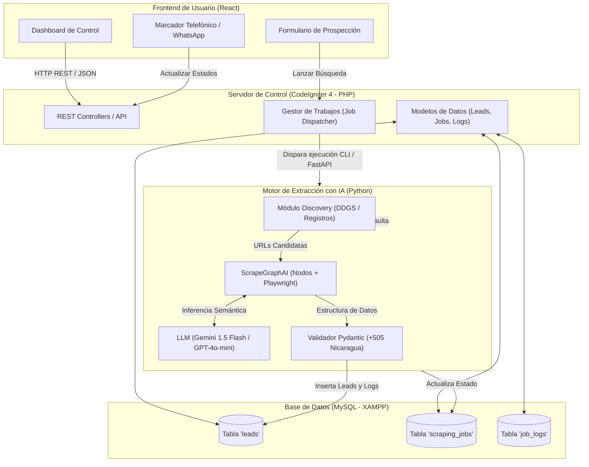

# Arquitectura del Sistema - Scraph

Este documento describe la estructura técnica y de diseño de software para **Scraph**, separando claramente las responsabilidades entre el motor de scraping con IA (Python), el servidor de control y APIs (CodeIgniter) y la interfaz de usuario (React).

---

## 1. Visión General de la Arquitectura

El sistema se compone de una arquitectura desacoplada en tres capas principales que comparten una base de datos central en MySQL:

---

## 2. Descripción de Componentes

### 2.1. Capa de Presentación: Frontend en React
- **Ubicación:** Subdirectorio `frontend/` (compilado hacia `public/dist/` de CodeIgniter o servido como SPA).
- **Responsabilidades:**
  - **Panel de Prospección:** Formulario interactivo donde el usuario elige: Sector (ej. *Microcréditos / Préstamos personales*), Ciudad (ej. *Chinandega*), Cantidad de prospectos y Fuente (*Web abierta* o *PDF CONAMI*).
  - **Monitor de Trabajos:** Visualización en tiempo real del progreso del scraping (barra de porcentaje, páginas analizadas, registros añadidos).
  - **Marcador Dial CRM:** 
    - Tarjetas o tabla ágil para llamadas.
    - Botones de acción rápida: `tel:+505XXXXXXXX` (llamada con softphone/móvil) y `wa.me/505XXXXXXXX` (WhatsApp directo con mensaje personalizado).
    - Cambio de estado instantáneo: *Pendiente*, *Llamado - Interesado*, *No contesta*, *Número equivocado*, *Descartado*.
    - Campo de notas rápidas por llamada.

---

### 2.2. Capa de Negocio y Control: Backend en CodeIgniter 4 (PHP)
- **Ubicación:** Raíz del proyecto en `c:\xampp\htdocs\Scraph\`.
- **Por qué CodeIgniter:** Ofrece un control granular, excelente velocidad de procesamiento en Apache, configuración nativa con MySQL en XAMPP y seguridad para endpoints REST.
- **Módulos principales:**
  - `App\Controllers\Api\LeadsController.php`: CRUD de prospectos, filtros por sector/ciudad/estado, paginación y exportación (CSV/Excel).
  - `App\Controllers\Api\JobsController.php`: Recibe la orden de prospección, crea el registro en `scraping_jobs` y lanza el proceso de Python en segundo plano (`proc_open` o llamada a microservicio).
  - `App\Controllers\Api\StatsController.php`: Métricas de conversión de llamadas (cuántas llamadas se hicieron, cuántos interesados, tasa de contacto).
  - `App\Models\LeadModel.php`, `JobModel.php`, `LogModel.php`.

---

### 2.3. Capa de Inteligencia y Extracción: Motor Python
- **Ubicación:** Subdirectorio `engine/`.
- **Tecnologías:**
  - **Python 3.10+**: Entorno aislado con `venv`.
  - **DuckDuckGo Search (`ddgs`)**: Descubrimiento de enlaces públicos de empresas y clasificados en Chinandega sin coste de APIs externas.
  - **ScrapeGraphAI (`SmartScraperGraph`)**: 
    - Extrae datos semánticos sin depender de clases CSS o XPath fijos.
    - Preprocesa el HTML a Markdown limpio antes de enviarlo al modelo.
  - **Playwright**: Renderizado de páginas con JavaScript dinámico.
  - **Pydantic**: Tipado estricto y garantía de formato en la respuesta.
  - **PyMySQL**: Conexión de alta velocidad con la base de datos de XAMPP.

---

### 2.4. Capa de Datos: MySQL (XAMPP)
- Base de datos relacional para persistencia.
- Manejo de restricciones de unicidad (`UNIQUE INDEX`) sobre el teléfono internacional normalizado para evitar que el sistema contacte dos veces al mismo número.
- Historial de llamadas y auditoría de eventos.

