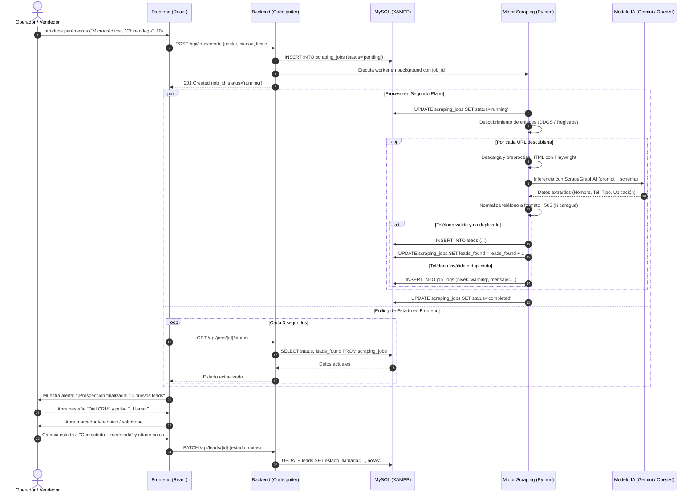

# Flujo de Trabajo y Ciclo de Vida (Workflow) - Scraph

Este documento detalla el ciclo de vida completo de un proceso de prospección y gestión de llamadas en **Scraph**, desde el momento en que el usuario ingresa los criterios en la interfaz hasta que el prospecto es contactado.

---

## 1. Diagrama de Secuencia del Flujo General

---

## 2. Fases Detalladas del Pipeline

### Fase 1: Entrada y Validación del Trabajo
1. El usuario accede al Dashboard y define:
   - **Sector objetivo:** ej. `Microcréditos`, `Prestamistas particulares`, `Casas de empeño`, `Talleres mecánicos`.
   - **Ubicación:** `Chinandega` (ampliable a León, Managua u otros departamentos).
   - **Modo de extracción:**
     - *Modo Búsqueda Abierta:* Consulta web en tiempo real.
     - *Modo Registro Oficial:* Carga o análisis de documentos estructurados (PDF de CONAMI / ASOMIF).
   - **Límite de empresas a extraer:** 5, 10, 20 o 50.
2. CodeIgniter valida los datos, genera un `job_id` y delega la ejecución de forma asíncrona al motor en Python para no bloquear la petición HTTP del navegador.

---

### Fase 2: Descubrimiento Inteligente de Enlaces (Discovery)
El motor de Python genera combinaciones booleanas de búsqueda enfocadas en el país:
- `site:encuentra24.com/nicaragua-es "prestamos" "chinandega"`
- `"microcreditos" "chinandega" (whatsapp OR telefono OR celular)`
- `"financiera" "chinandega" sucursal contacto`

**Filtro de exclusión:**
El motor descarta automáticamente dominios genéricos o redes sociales cerradas que no contengan páginas de contacto útiles (`facebook.com`, `instagram.com`, `wikipedia.org`, `youtube.com`).

---

### Fase 3: Análisis y Extracción con ScrapeGraphAI
1. **Renderizado:** Playwright descarga el sitio web simulando un navegador de escritorio (Chrome) para renderizar JavaScript.
2. **Compactación:** ScrapeGraphAI convierte el DOM a Markdown o texto denso, ahorrando más del 70% de tokens de contexto.
3. **Inferencia con LLM:** Se envía el texto limpio con un prompt estructurado y el esquema Pydantic:
   - *¿Quién presta?* (Nombre de la persona o de la financiera).
   - *¿Qué tipo de entidad es?* (`Microfinanciera / Empresa`, `Prestamista Particular`, `Cooperativa`).
   - *¿Cuál es el número de contacto?* (8 dígitos locales).
   - *¿Qué detalles o requisitos mencionan?* (sin aval, con garantía, prendario, personal).

---

### Fase 4: Limpieza, Validación y Deduplicación
Antes de tocar la base de datos:
1. **Regla de Teléfono Nicaragua (+505):**
   - Se extraen únicamente los dígitos.
   - Si tiene 8 dígitos válidos (móviles 8XXX-XXXX, 7XXX-XXXX, 5XXX-XXXX o fijos 2XXX-XXXX), se estandariza con el código internacional `+505`.
   - Si no cumple el formato o no hay número, **se descarta automáticamente** (porque el fin del sistema es la llamada telefónica).
2. **Chequeo de duplicados:** Se comprueba contra el índice único de la tabla `leads`. Si el teléfono ya existe, se omite para evitar llamadas repetidas a un mismo cliente.

---

### Fase 5: Operación en el Marcador (Dial CRM)
Los leads aparecen ordenados en el panel de React con herramientas para el operador:
1. **Marcado 1-Clic (`tel:`):** Al pulsar el botón azul, se dispara la llamada en el softphone del PC (MicroSIP, Skype) o directamente en la app del teléfono móvil si se usa desde el navegador del celular.
2. **WhatsApp 1-Clic (`wa.me`):** Si no contestan la llamada, el operador pulsa el botón verde de WhatsApp para enviar un mensaje de presentación predefinido:
   > *"Hola, le contacto en referencia a la información de financiamiento y microcréditos en Chinandega. ¿Con quién tengo el gusto?"*
3. **Calificación del Lead:** El operador registra el resultado en 2 clics:
   - `Pendiente` (por defecto)
   - `Contactado - Interesado`
   - `No contesta` (para reintentar después)
   - `Número equivocado / Inválido`
   - `Descartado / No le interesa`

